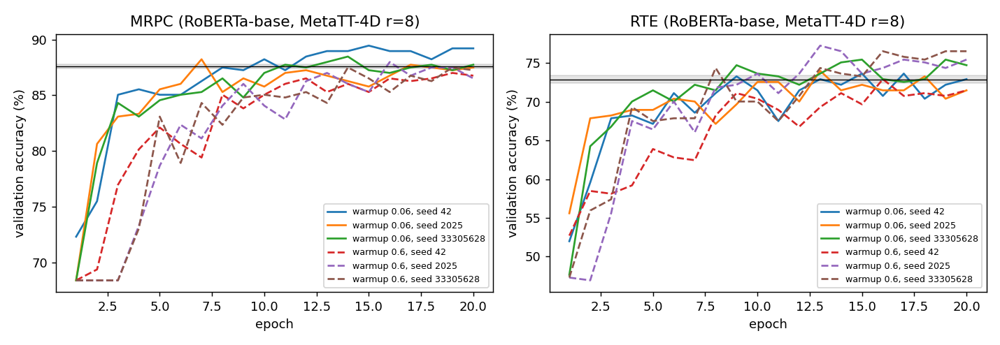

# MetaTT（TMLR 2026）の再現

> **English summary.** MetaTT-4D (one tensor train shared by all Q/V projections of a transformer) re-implemented from the paper's Eq. (5) and appendix pseudo-code, with no official code available. Target: the smallest experiment of the paper, one cell of Table 2. That cell is RoBERTa-base with MetaTT-4D rank 8 (13,184 trainable parameters, paper: 13k) on GLUE MRPC and RTE, 3 seeds, 20 epochs; the paper reports 87.6 ± 0.2 and 72.9 ± 0.5 accuracy. **Reproduced.** With warm-up ratio 0.06 we obtain **MRPC 88.73 ± 0.37 and RTE 74.37 ± 0.55** (best of 20 epochs; final epoch 88.15 ± 0.54 and 73.04 ± 0.94, both within one combined standard error of the paper's values). With the warm-up ratio printed in the paper (0.6) we obtain MRPC 87.50 ± 0.28 and RTE 75.57 ± 1.34. Under every reading of the two settings the paper leaves open, the paper's values are reached or exceeded; the largest shortfall is 0.75 points (MRPC, warm-up 0.6, final epoch). The trainable-parameter counts of all five MetaTT-4D rows of Table 2 match, and the frozen classifier head is unchanged after training. Environment: Google Colab, A100 GPU (high-RAM runtime), fp32. Details in `説明資料.md` (Japanese).

[](https://colab.research.google.com/github/0x6869726f6b69/paper-reproductions/blob/main/papers/2026-tmlr-metatt/reproduction/MetaTT_min_colab.ipynb)
（表 2 の MRPC・RTE を回したノートブックを Colab で開く）

## 論文
- Javier Lopez-Piqueres, Pranav Deshpande, Archan Ray, Mattia J. Villani, Marco Pistoia, Niraj Kumar. "MetaTT: A Global Tensor-Train Adapter for Parameter-Efficient Fine-Tuning." *Transactions on Machine Learning Research*, 2026. https://openreview.net/forum?id=1HdcPWfA9s ／ arXiv:2506.09105（v2：2025-11-14、v3：2026-07-02 の TMLR 採択版）
- **公式コード**：なし（2026-11-25 に確認。GitHub の検索で 0 件、arXiv のページにもリンクなし）。付録 E（v2）/ 付録 H（v3）に MetaTT-4D の擬似コードがあるだけ。
- **提案手法**：transformer のすべての層・すべての射影行列（Q、V など）の更新 ΔW を、1 本のテンソルトレイン `G1 · G2[層] · G3[行列の種類] · G4` で表す。パラメータ数が層数と行列の種類の数の「積」ではなく「和」で増えるので、LoRA よりずっと少ないパラメータで済む。

## 結果：表 2 の MRPC・RTE（RoBERTa-base、MetaTT-4D、ランク 8）
**判定：✅ 再現できた（3 シード）**。論文が決めていない 2 点（warmup ratio、最良・最終エポックのどちらを取るか）の 4 通りの読み方すべてで、論文の値に届くか上回ります。論文を下回るのは最大 0.75 点です。

| タスク | warmup | 本再現：最良エポック（主） | 本再現：最終エポック | 論文（表 2） | 差（最良 − 論文） | 差（最終 − 論文） |
|---|---|---|---|---|---|---|
| MRPC | 0.06 | **88.73 ± 0.37** | 88.15 ± 0.54 | 87.6 ± 0.2 | +1.13 | +0.55 |
| RTE | 0.06 | **74.37 ± 0.55** | 73.04 ± 0.94 | 72.9 ± 0.5 | +1.47 | +0.14 |
| MRPC | 0.6（論文の印刷どおり） | **87.50 ± 0.28** | 86.85 ± 0.22 | 87.6 ± 0.2 | −0.10 | −0.75 |
| RTE | 0.6（論文の印刷どおり） | **75.57 ± 1.34** | 74.49 ± 1.54 | 72.9 ± 0.5 | +2.67 | +1.59 |

- 指標は GLUE の検証データ（MRPC 408 件、RTE 277 件）の正解率です。各ランで 20 エポックの最良と最終を取り、3 シード（33305628、2025、42）の平均 ± 標準誤差を出しています。学習したパラメータは全ランで 13,184（論文 13k）です。分類ヘッドは、全ランで学習の前後で変わっていません。
- 補足として、MRPC の F1（最良エポック）は warmup 0.06 で 91.83 ± 0.29、0.6 で 90.92 ± 0.30 です。論文の表 2 は MRPC も正解率で比べています。
- 置き場所は次のとおりです。
  - シードごとの値（最良・最終・F1・学習時間）：[`results/summary.csv`](results/summary.csv)
  - 各ランのすべての記録（エポックごとの正解率と損失、実行環境）：`results/runs/`
  - 学習曲線：[`results/curves.png`](results/curves.png)
  - パラメータ数の照合：[`results/param_check.md`](results/param_check.md)
  - ファイルの説明：[`results/README.md`](results/README.md)
  - 考察：[`説明資料.md`](説明資料.md) の §6



**わかったこと**
- **論文の値に届く**：13,184 パラメータ（LoRA ランク 8 の約 22 分の 1）で、3 シードの平均が MRPC 86.9〜88.7、RTE 73.0〜75.6 です（4 通りの読み方の範囲）。論文を下回るのは、MRPC の warmup 0.6・最終エポック（−0.75、約 3 件分）だけです。
- **最終エポックで比べると、warmup 0.06 は 2 タスクとも論文と標準誤差の範囲で一致**します（+0.55、+0.14）。論文の値は、シードごとの最終エポックの値の範囲に入ります（MRPC 87.50〜89.22、RTE 71.48〜74.73）。最良エポックで比べると、論文より 1〜1.5 点（4〜5 件分）高くなります。論文がどちらを使ったかは書かれていないので、ここでは決めていません。
- **warmup 0.6 では学習の立ち上がりが遅い**：MRPC では 3 シード中 2 シードで、最初の 3 エポックが多数派クラスだけを答えるときの正解率（68.38）のままです（warmup 0.06 では長くても 1 エポック）。MRPC の最良は warmup 0.06 より 1.2 点低くなります。印刷どおりの 0.6 では、MRPC の最良が論文とほぼ同じです（−0.10）。ただし RTE は論文より 2.7 点高いので、warmup がどちらだったかはこの結果からは決められません。
- **RTE はシードによるばらつきが大きい**：検証データが 277 件と小さく、1 件で 0.36 点動きます。warmup 0.6 では、シードによって 72.9〜77.3 と 4 点以上違います。
- **ハイパーパラメータの行**：表 6 / 表 14 で使った行は「ランク 4」と印刷されています。しかしランク 4 だとパラメータ数は 6,368 で、表 2 の 13k になりません。この行をランク 8 として使うと論文の値に届いたので、ランク 8 の行の誤記とみてよさそうです。

## 実験環境
| 項目 | 内容 |
|---|---|
| 計算環境 | **Google Colab、A100 GPU・ハイメモリのランタイム**。CPU のテストとパラメータ数の照合は Windows 11 のノート PC |
| GPU | NVIDIA A100-SXM4-80GB（1 枚）。ランを最大 6 本ずつ並列に回した。論文は A100（40 GB）8 枚で、1 枚に 1 モデル |
| Python・主なライブラリ | Colab：Python 3.13.16、torch 2.14.1+cu130、transformers 5.22.1、datasets 4.8.5。CPU テスト：Python 3.11.9、torch 2.9.1（CPU）、transformers 5.24.0、datasets 5.2.0 |
| 数値の精度 | fp32（TF32 も使わない） |
| 時間 | 1 本あたりの学習時間は MRPC 約 25 分（9,180 ステップ）、RTE 約 22 分（3,120 ステップ）。6 本同時に回して、12 本で約 50 分 |
| 実行日 | 2026-11-24 17:15〜18:06 UTC（日本時間では 2026-11-25） |
| コードの版 | ノートブックのコードの版 `85a22862cd`。このリポジトリのコードと同じ |

## 論文との条件の比較
✓ = 論文と同じ、△ = 論文の記述を解釈した、? = 論文に書かれていない（こちらで決めた）、**要検討** = 同じかどうか確かめられていない。

| 項目 | 論文の記述 | 本再現 | 一致 |
|---|---|---|---|
| モデル | RoBERTa-base（表 2） | `FacebookAI/roberta-base` | ✓ |
| アダプタ | MetaTT-4D、ランク 8、13k（表 2）。Q・V に適用（付録 D.2 / G.2） | 同じ。13,184 | ✓ |
| 初期化 | G1 = 0、ほかは単位行列（「大半の実験で」、付録 D.4 / G.4） | 同じ | △ |
| 分類ヘッド | 学習しない（3.1 節） | 凍結（シードで決まる乱数の初期値のまま）。学習の前後で変わらないことを毎回確認 | ✓ |
| α・学習率・バッチ | 表 6 / 表 14 の RoBERTa-base の最初のブロック（ランクの欄は「4」） | MRPC：0.5 / 1e-3 / 8、RTE：4 / 1e-3 / 16（ランク 8 の行として使用） | △ |
| エポック・系列長・weight decay | 20、256、0（付録 D.4 / G.4） | 同じ | ✓ |
| warmup ratio | 0.6（GLUE の段落）。ほかの実験は 0.06 | 0.06 と 0.6 の両方 | **要検討** |
| 最適化 | HF の Trainer（付録 D.3 / G.3）。optimizer などは書かれていない | Trainer の既定値（AdamW、線形スケジュール、勾配クリップ 1.0）を自前のループで再現 | ? |
| 評価データ・指標 | 正解率（表 2）。データの分割は書かれていない | GLUE の検証データ（MRPC 408 件、RTE 277 件）の正解率 | ? |
| 報告値 | 平均と標準誤差（表 2）。最良・最終のどちらかは書かれていない | 20 エポック中の最良（主）と最終の両方 | ? |
| シード | 33305628、2025、42（付録 D.1 / G.1）、3 回 | 同じ | ✓ |
| 計算機・精度 | A100 × 8。精度は書かれていない | A100 × 1、fp32 | ? |

**要検討の点**
1. **warmup ratio**：GLUE の段落だけ 0.6 で、ほかの実験はすべて 0.06 です（v3 でも同じ）。両方回しましたが、どちらでも論文の値に届き、どちらが正しいかは決められませんでした。0.6 だと MRPC は論文とほぼ同じで、RTE は論文より高くなります。0.06 だと 2 タスクとも、最良エポックでは論文より高くなります。
2. **ハイパーパラメータの行のランク**：表 6 / 表 14 の行は「ランク 4」ですが、表 2 にランク 4 の行はなく、13k はランク 8 でしか出ません。誤記とみなしてランク 8 に使い、論文の値に届きました。
3. **報告値の取り方**：表 2 が最良エポックか最終エポックかは書かれていません。表 4 とマルチタスクの実験が最良エポックなので、主には最良を使いました。ただ、warmup 0.06 では最終エポックのほうが論文に近くなります（2 タスクとも標準誤差の範囲）。

## このフォルダの中身
| 場所 | 中身 |
|---|---|
| `README.md` | この説明 |
| `説明資料.md` | 詳しい説明（手法のしくみ、論文とコードの対応、決めた設定とその理由、論文の中の不整合、テスト） |
| `method/metatt/` | 論文の手法（MetaTT-4D）のコード |
| `reproduction/MetaTT_min_colab.ipynb` | Colab のノートブック（コード入り。これだけで回せる） |
| `reproduction/metatt_repro/` | 再現実験のコード（学習、並列実行、集計、パラメータ数の照合） |
| `reproduction/tests/test_core.py` | CPU のテスト（9 件） |
| `reproduction/tools/make_notebook.py` | ノートブックを作るスクリプト（コードを変えたら実行する） |
| `results/README.md` | 結果のファイルの説明と実験環境 |
| `results/report.md` | 論文との比較表（シードごとの値と最良のエポックつき） |
| `results/summary.csv` | ランごとの値（12 行：最良・最終の正解率、MRPC の F1、学習時間、環境） |
| `results/runs/` | 各ランのすべての記録（`result.json`：設定、エポックごとの正解率と損失、実行環境） |
| `results/curves.png` | 学習曲線（12 本、エポックごとの検証データの正解率） |
| `results/param_check.md` | 表 2 の MetaTT-4D の 5 行のパラメータ数の照合 |

## 回し方
**Colab**：`reproduction/MetaTT_min_colab.ipynb` を Colab で開き、「ランタイムのタイプ」で A100 GPU・ハイメモリを選んで「すべてのセルを実行」。結果は `MyDrive/MetaTT_repro/results` に保存され、最後のセルに論文との比較表と学習曲線が出る。

**手元**（GPU がある場合）：
```
cd reproduction
python tests/test_core.py
python -m metatt_repro.count
python -m metatt_repro.pipeline --out results_run --parallel 2
python -m metatt_repro.report --out results_run
```

## この再現の課題（言えないこと）
ここで再現できたと言えるのは、「論文に書かれた手順で、論文の値に届く」ことです。表 2 の RoBERTa-base・MetaTT-4D ランク 8 の MRPC と RTE が対象です。次のことは言えません。

| 課題 | 内容 | 次にやるなら |
|---|---|---|
| 数値がぴったり一致したわけではない | warmup 0.06（論文のほかの実験と同じ値）の最良エポックでは、論文より 1.1〜1.5 点高く、標準誤差の範囲を超えます。論文に印刷された設定（warmup 0.6・最良エポック）では、論文の値は本再現の 3 シードの範囲に入ります（MRPC 87.01〜87.99、RTE 72.92〜77.26）。ただし RTE の平均は 2.7 点高いです。論文より高いので主張とは矛盾しませんが、手順のどこかが論文と違う可能性があります | 違いの候補（warmup、最良か最終か、Trainer の細かい既定値、評価データの分け方、数値の精度）を 1 つずつ変えて比べる |
| 論文の手順を特定できていない | 論文に書かれていない warmup（0.06 か 0.6 か）と報告値（最良か最終か）の 4 通りは、どれも論文の値に届きました。結果を見てから合うものを選ぶのは後付けになるので、選んでいません | 著者に確かめる（公式コードはない） |
| ベースラインとの比較をしていない | MetaTT だけを再現する方針なので、LoRA などは回していません。「LoRA より桁違いに少ないパラメータで同じくらいの性能」という比較の部分は確かめていません | 同じ枠組みで LoRA（ランク 8、294,912 パラメータ）を回す |
| 再現したのは論文の一部だけ | 回したのは表 2 の 1 か所だけです。次は回していません：表 2 のほかの行（RoBERTa-base のランク 24・64、RoBERTa-large、MetaTT-5D）、ほかの 6 つの GLUE タスク（CoLA、MNLI、QNLI、QQP、SST-2、STS-B）、Llama-2 の常識推論、マルチタスクの実験 | GLUE の読み込みと評価指標は 8 タスクに対応済み。`paper.py` に表 6 / 表 14 のタスクごとのハイパーパラメータとランクを足して回す |
| シードが 3 つだけ | 3 シードの標準誤差は、それ自体のぶれが大きいです。RTE は検証データが 277 件と小さく、シードによって最大 4.3 点違いました | シードを増やす |
| ハイパーパラメータの行を読み替えた | 表 6 / 表 14 の「ランク 4」の行をランク 8 の行として使いました。論文の値に届いたので誤記という読みと矛盾はしませんが、確かめたわけではありません | 著者に確かめる |

詳しくは [`説明資料.md`](説明資料.md) の §6 にあります。

## 引用（元の論文）
```bibtex
@article{lopez-piqueres2026metatt,
  title={Meta{TT}: A Global Tensor-Train Adapter for Parameter-Efficient Fine-Tuning},
  author={Javier Lopez-Piqueres and Pranav Deshpande and Archan Ray and Mattia Jacopo Villani and Marco Pistoia and Niraj Kumar},
  journal={Transactions on Machine Learning Research},
  issn={2835-8856},
  year={2026},
  url={https://openreview.net/forum?id=1HdcPWfA9s}
}
```
